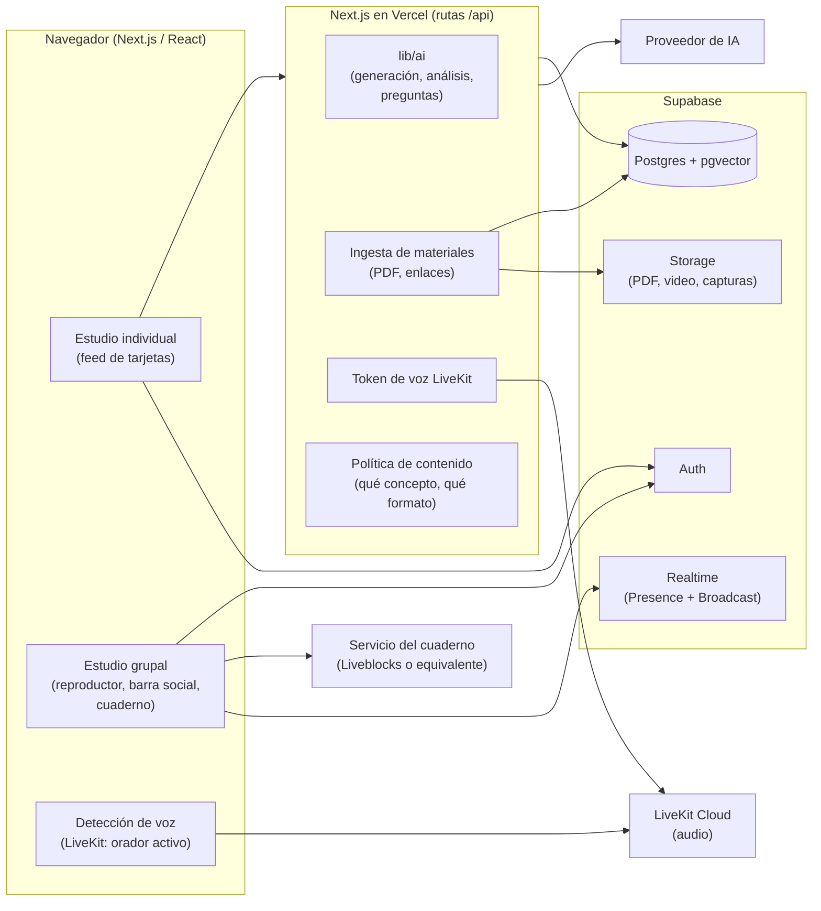

# Arquitectura, reglas de negocio y estructura del proyecto

Documento técnico para el Abstracthon 2026 (20 a 22 de noviembre). Nombre del producto: **pendiente** (hoy hay dos: SquadLearn y Futuro Yo Aprende; abajo se usa "la plataforma").

## 1. Decisiones tomadas

| Tema | Decisión |
|---|---|
| Track | Educación |
| Equipo | 3 personas |
| Stack | Next.js (App Router, TypeScript) + Supabase (Postgres, Auth, Realtime, Storage, pgvector), desplegado en Vercel |
| Alcance del MVP | Estudio individual F1 a F6 (Freddy) + estudio grupal F1 a F6 (Rua). Las funciones 7 a 13 (Andre) van a la hoja de ruta del pitch, sin construirse |
| Puente entre ambas partes | Mismo tema. La IA genera las preguntas de los puntos de control a partir del material; los resultados del debate alimentan el perfil individual |
| Voz | Real, con servicio gestionado (LiveKit Cloud) |
| Contenido del video | Propio o con licencia libre. No se usa contenido ni marca de Platzi |
| Acceso | Registro con correo o Google (Supabase Auth) |
| IA | Decisión mía: un modelo de lenguaje por API, encapsulado en un solo módulo (`lib/ai`) para poder cambiar de proveedor con una variable de entorno. Falta confirmar quién aporta la clave y el crédito |

## 2. Arquitectura



**Por qué esta forma.** Supabase reúne base de datos, sesión, tiempo real y almacenamiento en un solo servicio, así que no hay servidor propio que mantener. Lo único que no cabe ahí es el audio entre personas (LiveKit) y el cuaderno con cursores en vivo (se propone Liveblocks con su plan gratuito; si falla, se cae a bloques con "gana la última escritura" sobre Supabase Realtime).

### 2.1 Estudio individual

1. **Perfil de entrada (F1 y F2).** Un formulario recoge el tema, los intereses, el contexto de la persona y su nivel declarado. La IA analiza esos datos y devuelve como máximo 5 preguntas aclaratorias que falten para armar el recorrido. Todo se guarda en `learner_profile`.
2. **Materiales propios (F3).** La persona puede subir PDF o pegar enlaces. El servidor extrae el texto, lo divide en fragmentos de unos 500 tokens, calcula los embeddings y los guarda en pgvector. Toda generación posterior se apoya en estos fragmentos (recuperación aumentada) y cita de cuál sale cada afirmación.
3. **Tarjetas de contenido (F4).** Cada tarjeta es un objeto JSON con un `tipo` y un contenido estructurado. Los tipos del MVP son: `razonamiento` (paso a paso), `historia` (ejemplo con la vida de la persona), `lectura` (fragmento del material propio), `juego` (preguntas de opción, ordenar, completar), `visual` (diagrama generado) y `video` (de un catálogo corto, preparado de antemano). Cada tipo tiene su propio componente de pantalla.
4. **Generación en vivo (F5).** El feed se genera tarjeta a tarjeta con respuestas en streaming. Mientras la persona lee una tarjeta, el servidor ya genera las dos siguientes. La política de contenido (punto 5) decide el concepto y el formato de cada una antes de pedirla al modelo.
5. **Telemetría y política (F6).** El cliente envía eventos a `learning_events`. Con ellos se mantiene un `mastery` por persona y por concepto, y una estimación de qué formato le funciona mejor con cada concepto. No se asume un "estilo de aprendizaje" fijo (la evidencia no lo respalda, Pashler et al. 2008). Ver reglas en el punto 3.

### 2.2 Estudio grupal

- **Sala y presencia.** Cada sala es un canal de Supabase Realtime. Cada integrante envía por Presence su posición en el video (una vez por segundo), su estado (viendo, pausado, escribiendo en el cuaderno, hablando) y su avatar.
- **Reproductor.** Un reproductor HTML5 propio (no se modifica ningún reproductor ajeno). Expone eventos de reproducir, pausar, buscar y cambiar de volumen para que el resto de funciones los usen.
- **Voz.** Cada integrante se conecta a una sala de LiveKit. El propio LiveKit indica quién es el orador activo, y con eso se decide la pausa y el volumen sin procesar el audio en el cliente. No se graba ni se transcribe.
- **Puntos de control.** Se guardan en base de datos (minuto, pregunta, opciones, respuesta correcta, explicación). Los votos viajan por Broadcast y se confirman en Postgres.
- **Cuaderno.** Editor tipo bloques con cursores de colores, sincronizado por el servicio del cuaderno. Las capturas de fotograma se dibujan en un canvas desde el video, se suben a Storage y se insertan como bloque de imagen.

### 2.3 Puente entre las dos partes

- Una sesión de grupo pertenece a un `topic` (tema), el mismo concepto que usa el estudio individual.
- Las preguntas de los puntos de control las genera la IA a partir del material del tema, antes de la sesión. El anfitrión puede revisarlas y editarlas.
- Cuando se cierra un punto de control, cada voto (con su acierto y si cambió de opinión en el debate) genera un evento que actualiza el `mastery` individual de ese concepto.
- Un concepto con votos divididos queda marcado como "para debatir en grupo" y aparece como sugerencia en el panel individual.

## 3. Reglas de negocio

Las marcadas con (*) son supuestos míos que el equipo debe confirmar, porque el diseño no los define.

### Cuentas y salas
1. Para usar cualquier módulo hay que iniciar sesión con correo o Google.
2. Una sala admite de 2 a 5 integrantes. Quien la crea es el anfitrión. Se entra con un enlace o código de invitación, y el sexto intento de entrada se rechaza.
3. Una sala tiene un solo video y un solo tema, y solo puede haber una sesión activa a la vez.
4. Si el anfitrión se desconecta, el rol pasa al integrante que lleva más tiempo en la sala.

### Sincronía elástica
5. Cada persona controla su propio reproductor. Ningún evento de otro integrante mueve, pausa o acelera mi video por sí solo.
6. Una persona se considera **desfasada** cuando su posición difiere en más de 30 segundos de la mediana del resto (*). Con esto Carlos en 0:36 contra el resto en 1:10 sí lo está.
7. La causa que se muestra en el aviso ámbar sale del estado del cliente: "tomando notas" si tiene el cuaderno activo o escribiendo, "en pausa" si el video está detenido, "repasando" si retrocedió, "conversando" si la pausa viene de la voz (*).
8. "Esperarlo" pausa **solo mi** video hasta que esa persona alcance mi posición o yo reanude a mano (*). Nunca pausa el video de nadie más.
9. El contador "X/N sincronizados" cuenta a quienes están a menos de 30 segundos de la mediana.

### Zonas de fricción
10. Un **retroceso** es un salto hacia atrás de 5 segundos o más.
11. El video se divide en ventanas de 30 segundos (*). Una ventana pasa a ser **zona de fricción** cuando 2 o más integrantes distintos retroceden hacia ella en la misma sesión.
12. La etiqueta muestra el número total de retrocesos y el rango de la ventana. La zona no se borra durante la sesión.

### Voz y pausa automática
13. Cuando LiveKit reporta un orador activo, cada cliente baja el volumen del video al 15 % y lo pausa con un desvanecimiento (*, incluso si el orador es uno mismo).
14. Tras 3 segundos sin que nadie hable, se muestra la cuenta regresiva 3, 2, 1 y el video se reanuda restaurando el volumen.
15. "Mantener pausa" cancela la reanudación automática. El video solo vuelve cuando la persona lo reanuda a mano.
16. El audio no se graba ni se convierte a texto.

### Puntos de control y debate
17. Un punto de control tiene un minuto, una pregunta, de 2 a 4 opciones, una respuesta correcta y una explicación.
18. Cuando un integrante llega a ese minuto, su video se pausa y se abre su votación. Los demás lo hacen cuando lleguen (*, es una consecuencia de la sincronía elástica; el diseño dice que se pausa "para todos").
19. Los votos son a ciegas. Nadie ve el voto ajeno hasta que se revelan.
20. Se revelan cuando todos los integrantes conectados han votado, o a los 120 segundos del primer voto (*). Quien no votó queda fuera de ese punto de control.
21. Si hay una sola opción elegida, es "combo perfecto" cuando es la correcta y no se abre debate. Si hay dos o más opciones elegidas, se abre un debate de **90 segundos** y se permite cambiar el voto.
22. Al cerrar el debate se registra el voto final, se muestra la respuesta correcta con su explicación y todos reanudan.
23. Cada voto emite un evento de telemetría (acierto, cambió o no de voto) que actualiza el dominio individual del concepto.

### Cuaderno
24. El cuaderno es de la sala, lo editan todos a la vez y cada bloque registra su autor.
25. Se guarda automáticamente. "Snapshot" crea una versión del cuaderno que se puede consultar después (*). "Notion sync" queda fuera del MVP; en su lugar, se puede exportar el cuaderno a Markdown (*).
26. "Capturar frame" guarda el fotograma actual con su minuto y el nombre de quien lo capturó.

### Estudio individual
27. Cada tarjeta generada se guarda con su concepto, su formato y los materiales de los que salió. Se reutilizan tarjetas ya generadas antes de pedir otras al modelo.
28. El dominio (`mastery`) de un concepto va de 0 a 1, empieza en el nivel declarado por la persona y sube o baja con cada respuesta, ponderando más las recientes (*).
29. El siguiente concepto es el de menor dominio cuyos requisitos previos estén por encima de 0.6 (*).
30. El formato se elige por **exploración y explotación**: se prefiere el formato con mejor resultado observado para ese concepto en esa persona, pero 1 de cada 4 tarjetas se prueba con otro formato para no quedar atrapado en una conclusión temprana (*).
31. La persona siempre puede ver su perfil (nivel por concepto, formatos que le funcionan, señales recientes) y borrarlo.

### IA, costos y datos
32. Todas las llamadas al modelo pasan por el servidor. La clave nunca llega al navegador.
33. Límite de uso por persona y por día (*) para controlar costos, y el material subido se limita a 3 archivos de 10 MB por tema (*).
34. Al modelo solo se envía el tema, el perfil de aprendizaje y los fragmentos del material. Nunca el correo, el nombre completo ni datos de contacto.
35. La telemetría requiere aceptación explícita al registrarse, y la persona puede desactivarla (entonces la política de contenido usa solo lo declarado).
36. Todo contenido generado debe poder trazarse al fragmento del que sale. Si el material no cubre una pregunta, el sistema lo dice en lugar de inventar.

## 4. Modelo de datos (resumen)

`profiles` (id, nombre, avatar) · `topics` (id, título, descripción) · `concepts` (id, topic_id, nombre, requisitos[]) · `materials` (id, user_id, topic_id, tipo, url) · `material_chunks` (id, material_id, texto, embedding) · `learner_profile` (user_id, topic_id, intereses, contexto, nivel_declarado) · `cards` (id, user_id, concept_id, formato, contenido_json, fuentes[]) · `learning_events` (id, user_id, card_id, tipo, valor, creado) · `mastery` (user_id, concept_id, valor, actualizado) · `format_stats` (user_id, concept_id, formato, intentos, aciertos) · `rooms` (id, anfitrión, topic_id, video_id, código, estado) · `room_members` (room_id, user_id, rol) · `videos` (id, url, título, duración) · `checkpoints` (id, video_id, minuto, pregunta, opciones, correcta, explicación, generado_por_ia) · `votes` (checkpoint_id, room_id, user_id, voto_inicial, voto_final) · `friction_events` (room_id, ventana_inicio, retrocesos) · `notebooks` (room_id, contenido_ref) · `notebook_snapshots` (id, notebook_id, creado) · `captures` (id, room_id, user_id, minuto, url).

Las posiciones, el estado de voz y los cursores no se guardan: viven solo en Presence.

## 5. Estructura de carpetas

```
/app
  /(auth)/login
  /(app)/inicio                  panel con el perfil de dominio
  /(app)/individual/[tema]       feed de tarjetas
  /(app)/individual/nuevo        onboarding y subida de materiales
  /(app)/grupo/[codigo]          sala de estudio en grupo
  /api/ai/...                    análisis, tarjetas, preguntas de control
  /api/materiales/...            ingesta y fragmentos
  /api/voz/token                 token de LiveKit
  /api/eventos                   telemetría
/components
  /individual                    tarjetas por tipo, panel "lo que sabe la IA"
  /grupo                         reproductor, barra social, tarjeta de control, cuaderno
  /ui                            sistema de diseño compartido
/lib
  /ai                            proveedor, prompts, esquemas JSON
  /politica                      elección de concepto y formato
  /realtime                      canales, presencia y eventos de la sala
  /supabase                      clientes y tipos
/supabase/migrations
/docs                            README, hoja de ruta, evidencia
```

## 6. Reparto propuesto para 3 personas (*)

| Persona | Responsabilidad |
|---|---|
| Freddy | Estudio individual completo (F1 a F6), la política de contenido y el puente |
| Rua | Estudio grupal (F1 a F6): reproductor, presencia, voz, puntos de control |
| Andre | Base común (registro, navegación, diseño compartido, despliegue), cuaderno compartido, README, hoja de ruta con las funciones 7 a 13 y guion del pitch |

## 7. Plan de trabajo (≈ 20 horas)

| Momento | Objetivo |
|---|---|
| Viernes noche | Revisar la temática que revelen. Crear el repositorio público, el proyecto en Supabase, LiveKit y la clave de IA. Migraciones y esqueleto |
| Sábado, bloque 1 | Registro y navegación. Onboarding individual y primera tarjeta generada. Sala y presencia grupales |
| Sábado, bloque 2 | Tarjetas de varios formatos y subida de materiales. Reproductor con barra social. Voz |
| Sábado, bloque 3 | Telemetría y política de contenido. Puntos de control y debate. Cuaderno |
| Sábado, bloque 4 | Puente (resultados del debate al perfil). Pulido. Guion del pitch |
| Domingo mañana | Errores y estabilidad con 3 laptops en la misma sala. Datos de demo |
| Domingo tarde | Despliegue, README, ensayo del pitch. **Entrega a las 16:30** |

## 8. Riesgos y alternativas

| Riesgo | Alternativa |
|---|---|
| La voz con varias personas falla en la demo | Detección real con el micrófono propio y el resto simulado |
| El cuaderno en tiempo real no queda a tiempo | Bloques con "gana la última escritura" sobre Realtime |
| La generación tarda demasiado en vivo | Tarjetas pregeneradas del tema de la demo, guardadas en caché |
| Se agota el crédito de IA | Límites por persona (regla 33) y reutilización de tarjetas (regla 27) |
| La temática del viernes no encaja | Reencuadrar el problema (que no cambia) y el tema de demo, no el producto |

## 9. Pendientes de confirmar

1. Nombre único del producto.
2. Quién aporta la clave y el crédito de IA. Si se usa el incentivo de Bitget, hay que cumplir sus requisitos (mayoría de edad, depósito propio de 10 USD y documentos).
3. Video de demo con licencia libre (por ejemplo, una clase con licencia Creative Commons) y 5 a 8 preguntas de control para él.
4. Reglas marcadas con (*) en la sección 3.
5. La frase del "Problema central": generaliza sobre "el modelo actual" y deja ver la solución ("contenidos rígidos"). Conviene reformularla sin juicio sobre cómo se enseña hoy.
6. Las cifras de la landing (+380 %, 4.2x, 89 %, 3.8x) no tienen respaldo y no deben presentarse como resultados.
7. Qué videos preparados se incluyen en el catálogo del estudio individual.
